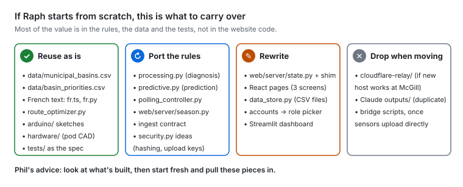
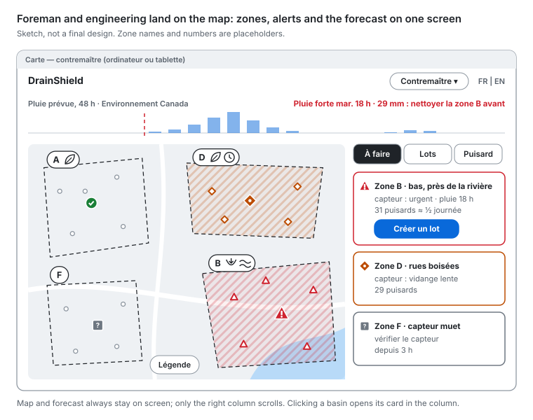
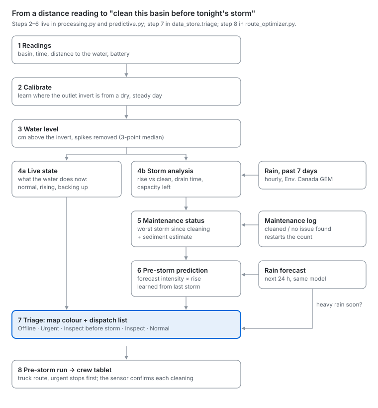
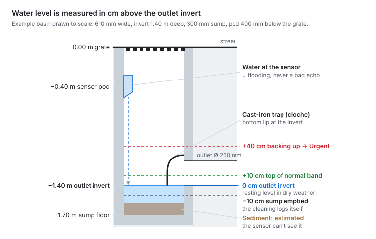
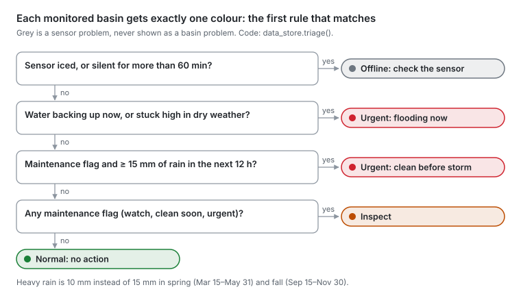
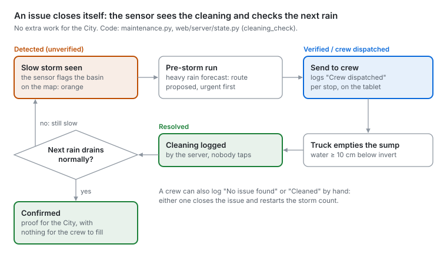
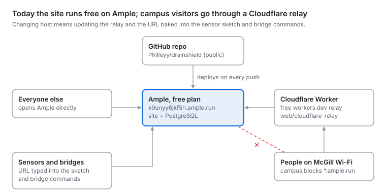

# DrainShield: handoff to Raph

*Written Nov 26, 2026. Phil (Philippe Bordeleau) is handing the software side to Raph. This file describes **today's code**. Where the product is going (role picker, one sensor per zone, cleaning batches, winter sleep, map first, French first) is in [REBUILD_SPEC.md](REBUILD_SPEC.md).*

## 1. The short version

- **You own the website.** You decide the stack, the structure, and what to rewrite. Phil handles the hardware, the municipalities, and the competition.
- **Phil's advice: look at what's built, then start from scratch and reuse parts of this code.** The new direction (zones, batches, role picker, three screens) is different enough that a fresh start will be cleaner. The valuable parts are the decision rules (section 4), the data files, the tests and the French text, not the website plumbing.



- **Hosting and domain are your call, with no rush.** The current site is free and works for demos. Hold off on buying a domain: the name "DrainShield" isn't final yet.
- **The direction changed on Nov 26** after an interview with Chambly's public works foreman. Read section 2 of this file, then [REBUILD_SPEC.md](REBUILD_SPEC.md).
- **The pitch demo and the judges' account were removed** from the code on Nov 26.
- **Everything passes today:** 24 engine tests (`tests/`) and 15 server tests (`web/tests/`).

## 2. What DrainShield is

A sensor pod sits on the wall of a street catch basin (puisard), about 400 mm below the grate, and measures the distance down to the water. The software turns those readings into two kinds of decisions for a city's public works team:

1. **Before storms (predictive maintenance):** find basins that drain slowly (sediment, a blocked trap, a covered grate). Cross that with Environment Canada's rain forecast so crews clean the risky ones *before* the storm.
2. **During storms (real time):** show which basin is backing up right now, so crews respond faster and limit flood damage.


**Customer:** smaller Québec municipalities. Dorval is the reference data set; Chambly, Stoneham, L'Assomption and Vaudreuil-Dorion have been contacted or interviewed. The city is the customer, not the cleaning contractors.

**Business model (decided Nov 25):** DrainShield owns the pods and does all field work (installs, repairs, batteries). The city gets a reliable product and software. **Hard constraint: DrainShield must not add to the city's workload or budget.**

**New direction (Nov 26), from Chambly's public works foreman:**
- **Not a sensor in every basin.** Put one sensor per **zone** of basins with similar conditions: leafy streets, low points, near the outfall or river, a history of problems.
- **Cleaning goes out in batches** of roughly half a day to a full day, never for a few scattered, non-critical basins. Contractors such as Sani-Vac are expensive. Cleaning takes about 5 minutes per basin. The contractor works on paper; the foreman logs the result.
- **Sensors sleep in winter** (clogging risk is near zero) and wake with the snowmelt, without anyone going out.
- **Zones are scored from data**: public lidar, flood history and OpenStreetMap first, then the city's office files. No field work for the city.
- **The website follows:** a role picker instead of sign-in, a map-first page for the foreman and engineering, a very simple crew screen for phone and tablet, French first, and alert icons that use shape as well as colour.



## 3. Where things stand (Nov 26, 2026)

| Done | Not done / open |
|---|---|
| Web app live on Ample, with sign-in, roles, upload keys | Final sensor: **60 GHz radar (Acconeer A121/XM125)** is the assumption, but the code is still written around ultrasonic sensors |
| Streamlit dashboard (original prototype, kept as a fallback) | Data link not chosen (LTE, LoRaWAN or Wi-Fi) |
| All 5,035 Dorval catch basins on the map (Ville de Montréal open data) | Battery not bench-tested (3 years at first, 5–10 years as the goal) |
| Pitch demo removed (Nov 26): the site shows live data only | Web app hasn't passed a full dry run yet |
| Wireless prototype: Heltec LoRa nodes → USB receiver → laptop → website | Name not final; no domain |
| ESP8266 Wi-Fi sketch posting straight to the website (being tested) | Sensor strategy: one per zone (decided Nov 26); pilot in Chambly: 2 sensors where basins rarely block, 2 where they often do |
| Pre-storm predictions, truck route, crew view, French and English | Thresholds are first guesses, not tuned on real pilot data |
| | Zones, batches, role picker, winter sleep: designed, not built ([spec](REBUILD_SPEC.md)) |

### The screens, from now on

The current screens will be redesigned, so there are no screenshots here. The new sketches are in [REBUILD_SPEC.md](REBUILD_SPEC.md#3-screens-three-in-total). The crew screen has to be the simplest of all:


## 4. How data becomes a decision

This is the heart of the project. All of it lives in the `.py` files in the repo root, shared by both apps.



### 4.1 One reading (the data contract)

`basin_id, timestamp, distance_cm, battery_v`. That's all the engine needs. Any sensor or radio works as long as it produces this. Switching from ultrasonic to radar mostly changes the blind zone and the noise, not the pipeline.

### 4.2 Distance → water level



- **Self-calibration:** in dry weather the sump water rests at the outlet invert. The first ≥ 6 steady dry hours after install (within the first 48) teach the sensor where that is, so nobody measures the sensor height. If the result is more than 15 cm off the as-built plans, the site warns. The invert depth can also be left blank and learned.
- A 3-point rolling median removes spikes. Readings stuck at the closest distance the sensor can measure mean the water is at the sensor, which is flooding, not a bad echo.

### 4.3 Storms → diagnosis

Rain comes from Environment Canada's GEM model via Open-Meteo (free, no key). A dry gap of 6 h or more separates two storms.


| Measure | OK | Watch | Clean soon | Urgent |
|---|---|---|---|---|
| Rise vs. the same basin when clean | ≤ 2× | ≤ 4× | ≤ 8× | more |
| Drain time after the rain stops | ≤ 30 min | ≤ 90 min | ≤ 180 min | more |
| Estimated sediment, % of the sump | < 60% | ≥ 60% | ≥ 80% | n/a |

- **Capacity left ≈ 1 ÷ rise ratio.** It's an estimate, and the site labels it that way.
- **Sediment is estimated, not measured:** rain × catchment area × sediment yield. It resets when a crew logs a cleaning, using the depth they measured.
- **The worst storm since the last cleaning sets the status**, because clogging doesn't fix itself. Confidence goes Low → Medium → High as 1, 2, then 3+ storms flag the basin.
- Constants live at the top of `processing.py`.

### 4.4 Two separate answers per basin

1. **Live state** (right now): normal · rising with the rain · not draining (high in dry weather) · backing up (> 40 cm above the invert, at the sensor, or above the subdrains) · no data (silent > 60 min) · learning.
2. **Maintenance status** (does a crew need to go?): OK · Watch · Clean soon · Urgent · No data.

### 4.5 Triage: one colour per basin



### 4.6 Pre-storm prediction (`predictive.py`)

```
predicted peak = water left when the rain starts + k × i_obs × (i_forecast / i_obs)^p
   k = cm of rise per mm/h, learned from this basin's last storm
   p = 1 for a lighter storm than observed, 2 for a heavier one (a restricted outlet acts like an orifice)
```

The basin gets 🔴 if the predicted peak is ≥ 40 cm or within 30 cm of the grate. It gets 🟠 if the peak is at least half of that, or if the basin drains 3× slower than when it was clean.

### 4.7 From flag to closed issue, with no extra work for the city



The run route (`route_optimizer.py`) uses nearest-neighbour then 2-opt, with urgent stops first. Road times come from the free OSRM server, with a straight-line fallback so a route is still planned offline. Runs start from the Dorval public works yard.

### 4.8 How often sensors read


## 5. The two apps in the repo


| | Streamlit dashboard | Web app (`web/`) |
|---|---|---|
| Run it | `python -m streamlit run app.py` | `cd web && python -m uvicorn server.main:app --reload` (run `npm install && npm run build` in `web/frontend` once first) |
| Data | CSV files in `data/` | PostgreSQL online, a SQLite file locally |
| Status | Original prototype, kept as a fallback | The product going forward |

Other folders: `arduino/` (3 sketches), `hardware/enclosure/` (pod CAD, STEP/STL), `data/` (Dorval basins + pilot priorities), `tests/`, `web/tests/`. `Claude outputs/` holds a duplicate sketch and can be deleted.

## 6. Users: who can do what

Today, accounts are invite-only: an admin creates them, and there's no sign-up page. **This is going away:** the spec replaces sign-in with a role picker (crew, foreman, engineering / geomatics). The old "demo" role was retired, and those accounts can no longer sign in.

| Role | Can |
|---|---|
| **admin** | Everything, plus create/disable accounts, reset passwords, make and revoke sensor upload keys |
| **engineering** | Add/edit/remove basins and sensors, change settings, plus everything crew can do |
| **crew** | See the network, open basins, follow runs, log maintenance |

**What users can change:**
- **Basins**, using as-built plan values (no catalogue models): ID, city ID, address, GPS, inside diameter (405/610/915/1220 mm), outlet invert depth (optional), outlet pipe (150–450 mm), sump (0/300/500 mm), sensor depth (default 400 mm), cast-iron trap yes/no. A basin can also be picked from the city map.
- **Maintenance log:** Crew dispatched, Inspected, Obstruction found, Requires further investigation, Cleaned / vacuumed (+ measured sediment), No issue found, Sensor installed / re-installed.
- **Pre-storm run:** remove stops, set the departure time.
- **Settings:** on-call foreman name and phone.
- **Switches:** French / English, light / dark.

## 7. Hardware context (it keeps changing)

- **In the code now:** Arduino Uno + HC-SR04 over USB; Heltec WiFi LoRa 32 V3 + A02YYUW ultrasonic nodes with a USB receiver (flash ring buffer, ACK carries the mode); ESP8266 + HC-SR04 over Wi-Fi.
- **Decided since:** 60 GHz radar (Acconeer A121/XM125 assumed), battery powered (3 years at first, 5–10 years as the goal), pod slides onto a wall bracket and is placed and removed from street level, waterproof, must survive winter. It sleeps in winter and wakes with the snowmelt; pods are not removed for the winter.
- **Heads-up:** the claude.ai project brief still describes an Arduino MKR WAN 1310 + DYP-A02YY ultrasonic. That's out of date.

## 8. Known shortcuts (marked `shortcut:` in the code)

- **One request at a time:** the engine keeps state in module globals, so `web/server/state.py` runs every computation under a lock.
- **Full database → CSV re-export** whenever data changes. Fine up to about 100k readings.
- **No migrations:** tables are created on start-up.
- **Readings and sensor status are keyed by `basin_id`**, so a pod can't move to another basin and keep its history.
- The upload reply already sends a seasonal dry interval (`dry_every_s`), but the firmware ignores it. The reading mode is still chosen on the laptop (`polling_controller.py`), not by the website.
- The OSRM server is a free public demo service.
- **All thresholds are first guesses.** The 915/1220 mm wall thicknesses are placeholders (`VERIFY` in `basin_model.py`). Battery % is a straight line from 3.20 to 3.60 V.

## 9. Hosting today, and the choices ahead



Settings are environment variables only (`DATABASE_URL`, `SETUP_TOKEN`, `COOKIE_SECURE`, `APP_TZ`), so nothing is tied to Ample.

| Option | Cost | Good for | Catch |
|---|---|---|---|
| Stay on Ample + Cloudflare relay | free | demos now | awkward; depends on a small host |
| Run locally only | free | development, bench tests on the same Wi-Fi | demos need Phil's laptop; nobody can sign in from elsewhere |
| Mainstream host + custom domain | usually a card on file, ~$15–25/yr domain | going public | decide once the name is final |

## 10. Constraints to keep, whatever you rebuild

- Free, with no credit card for now; portable, standard code.
- Never add work or cost for the city. The sensor confirms cleanings, instead of crews tapping "cleaned".
- A crew member answers "where, what, what do I do" in under 10 seconds on a tablet.
- Sensor problems (grey) never look like basin problems (red, orange, green).
- French first; English optional.
- Estimates (sediment, capacity) are labelled as estimates.
- Colour **and** shape for every alert, so colour-blind users can read the map.
- As few pages as possible: map and forecast visible together; adding basins and zones in a side column.

## 11. Suggested first week

1. **Get access** from Phil: GitHub collaborator, an admin account on the live site, and Ample + Cloudflare access if you take over hosting.
2. **Run the tests:** `python -m pytest -q tests` in the repo root, then `cd web && python -m pytest -q`.
3. **Run the web app locally** and feed it a bench sensor (`sensor_bridge.py` or the ESP8266 sketch). There is no demo data any more.
4. **Read the docstrings** of `processing.py`, `predictive.py` and `web/server/state.py`. They explain the *why*.
5. **Start fresh** from [REBUILD_SPEC.md](REBUILD_SPEC.md), pulling in the pieces in section 1's picture.

**Ask Phil about:** how zones should be drawn in practice, which city data he can get (sewer network, cleaning records), the L'Assomption demonstration, and anything in the "open" column of section 3.
