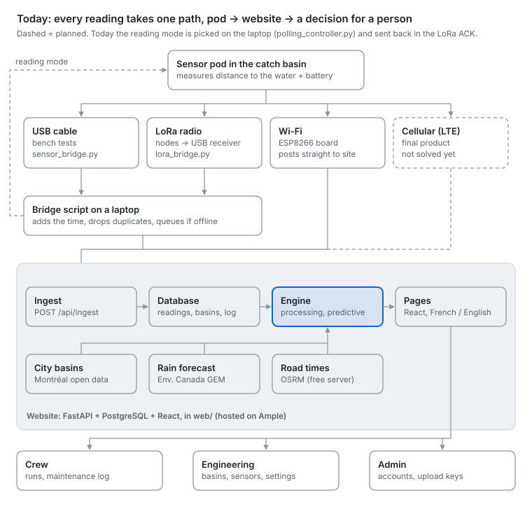
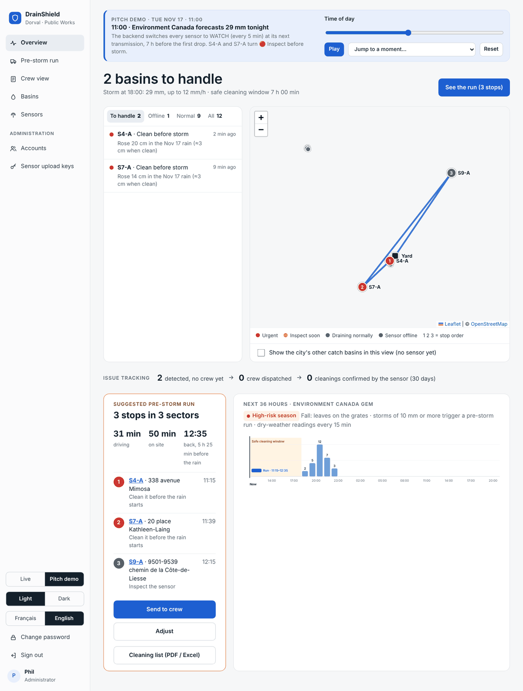
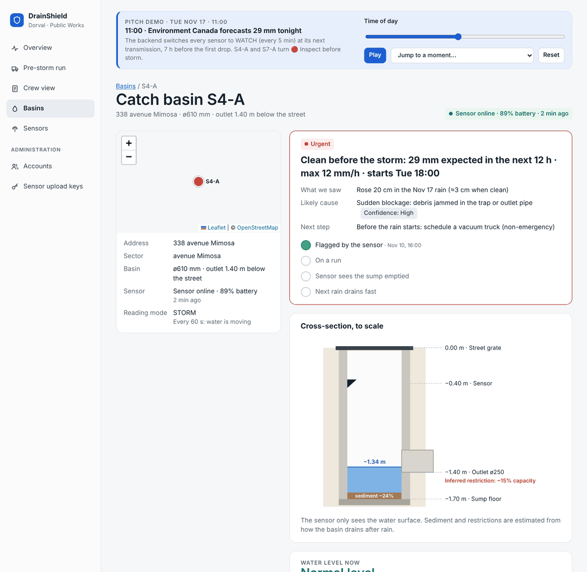
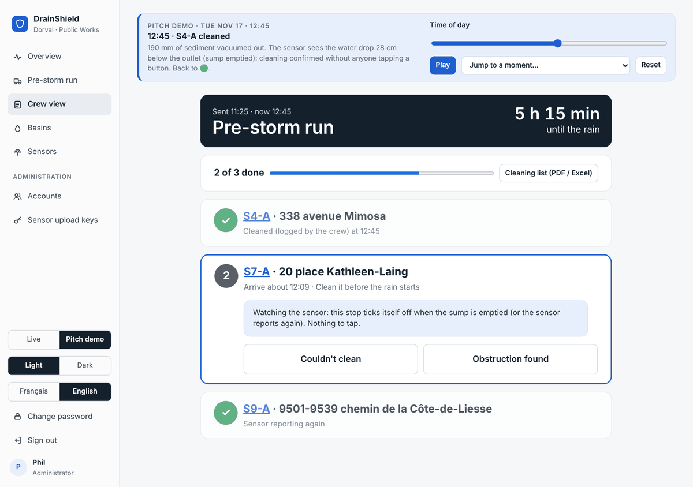
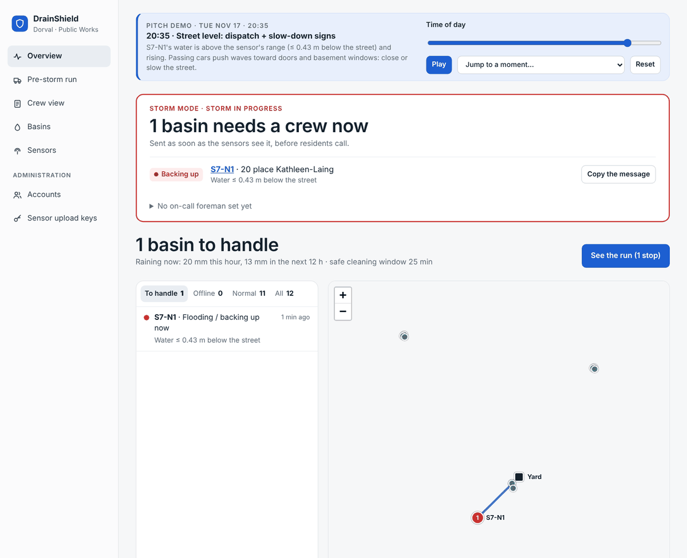
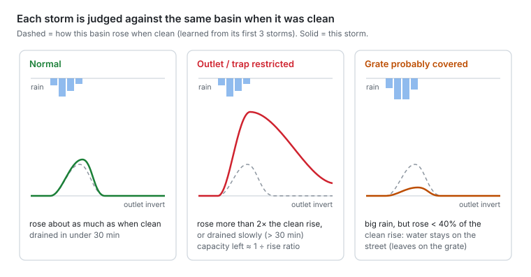
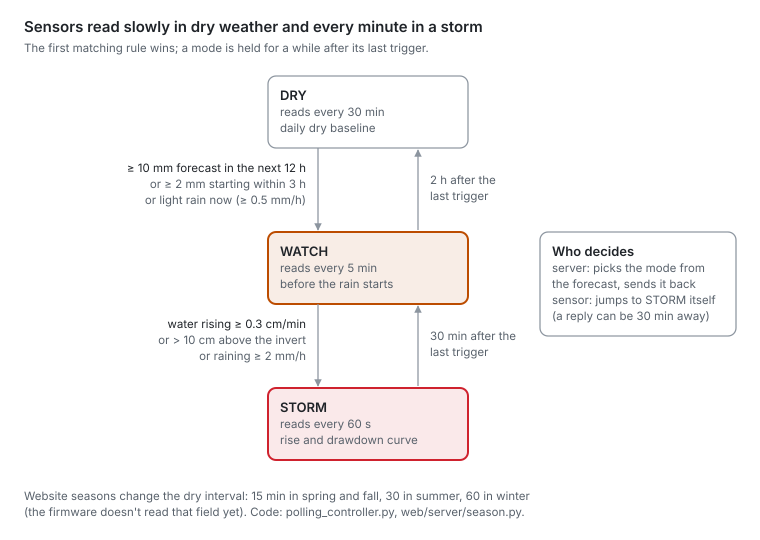
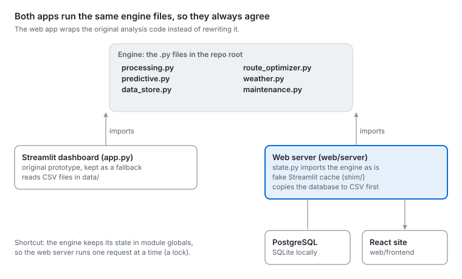

# DrainShield: handoff to Raph

*Written Nov 26, 2026, from the code at commit `2dc9452` (Nov 23). Phil (Philippe Bordeleau) is handing the software side to Raph. Want to start over? Read [REBUILD_SPEC.md](REBUILD_SPEC.md) instead: it describes what to build, not how today's code does it.*

## 1. The short version

- **You own the website.** You decide the stack, the structure, and what to rewrite. Phil handles the hardware, the municipalities, and the competition.
- **A rewrite is allowed, but read the code first.** It's already a standard stack: FastAPI + PostgreSQL + React/TypeScript. The valuable part is the decision logic (section 4), not the framework.
- **Hosting and domain are your call, with no rush.** The current site is free and works for demos. Hold off on buying a domain: the name "DrainShield" isn't final yet.
- **Everything passes today:** 27 engine tests (`tests/`) and 16 server tests (`web/tests/`).

## 2. What DrainShield is

A sensor pod sits on the wall of a street catch basin (puisard), about 400 mm below the grate, and measures the distance down to the water. The software turns those readings into two kinds of decisions for a city's public works team:

1. **Before storms (predictive maintenance):** find basins that drain slowly (sediment, a blocked trap, a covered grate). Cross that with Environment Canada's rain forecast so crews clean the risky ones *before* the storm.
2. **During storms (real time):** show which basin is backing up right now, so crews respond faster and limit flood damage.



**Customer:** smaller Québec municipalities. Dorval is the reference data set; Chambly, Stoneham, L'Assomption and Vaudreuil-Dorion have been contacted or interviewed. The city is the customer, not the cleaning contractors.

**Business model (decided Nov 25):** DrainShield owns the pods and does all field work (installs, repairs, batteries). The city gets a reliable product and software. **Hard constraint: DrainShield must not add to the city's workload or budget.**

## 3. Where things stand (Nov 26, 2026)

| Done | Not done / open |
|---|---|
| Web app live on Ample, with sign-in, roles, upload keys | Final sensor: **60 GHz radar (Acconeer A121/XM125)** is the assumption, but the code is still written around ultrasonic sensors |
| Streamlit dashboard (original prototype, kept as a fallback) | Cellular (LTE) link not solved |
| All 5,035 Dorval catch basins on the map (Ville de Montréal open data) | Battery life not bench-tested (target 5–10 years) |
| Pitch demo: a scripted 24-hour storm day, 4 pilot sites, 12 sensors | Web app hasn't passed a full dry run yet |
| Wireless prototype: Heltec LoRa nodes → USB receiver → laptop → website | Name not final; no domain |
| ESP8266 Wi-Fi sketch posting straight to the website (being tested) | One sensor per basin, or only critical ones? Undecided |
| Pre-storm predictions, truck route, crew view, French and English | Thresholds are first guesses, not tuned on real pilot data |

### The site today

These screenshots come from the pitch demo, run locally. The map tiles are blank only because the screenshot machine had no internet.

**11:00, before the storm.** The forecast says 29 mm tonight, two basins turn red ("clean before storm"), and a 3-stop run is proposed.



**The basin page:** what the sensor saw, the likely cause, the next step, a to-scale cross-section, and two numbers.



**12:45, crew view.** Stops tick themselves off when the sensor sees the sump emptied.



**20:35, during the storm.** One basin is backing up, and the crew is called before residents phone in.



## 4. How data becomes a decision

This is the heart of the project. All of it lives in the `.py` files in the repo root, shared by both apps.


### 4.1 One reading (the data contract)

`basin_id, timestamp, distance_cm, battery_v`. That's all the engine needs. Any sensor or radio works as long as it produces this. Switching from ultrasonic to radar mostly changes the blind zone and the noise, not the pipeline.

### 4.2 Distance → water level


- **Self-calibration:** in dry weather the sump water rests at the outlet invert. The first ≥ 6 steady dry hours after install (within the first 48) teach the sensor where that is, so nobody measures the sensor height. If the result is more than 15 cm off the as-built plans, the site warns. The invert depth can also be left blank and learned.
- A 3-point rolling median removes spikes. Readings stuck at the closest distance the sensor can measure mean the water is at the sensor, which is flooding, not a bad echo.

### 4.3 Storms → diagnosis

Rain comes from Environment Canada's GEM model via Open-Meteo (free, no key). A dry gap of 6 h or more separates two storms.



| Measure | OK | Watch | Clean soon | Urgent |
|---|---|---|---|---|
| Rise vs. the same basin when clean | ≤ 2× | ≤ 4× | ≤ 8× | more |
| Drain time after the rain stops | ≤ 30 min | ≤ 90 min | ≤ 180 min | more |
| Estimated sediment, % of the sump | < 60% | ≥ 60% | ≥ 80% | n/a |

- **Capacity left ≈ 1 ÷ rise ratio.** It's an estimate, and the site labels it that way.
- **Sediment is estimated, not measured:** rain × catchment area × sediment yield. It resets when a crew logs a cleaning, using the depth they measured.
- **The worst storm since the last cleaning sets the status**, because clogging doesn't fix itself. Confidence goes Low → Medium → High as 1, 2, then 3+ storms flag the basin.
- Constants live at the top of `processing.py`.

### 4.4 Two separate answers per basin

1. **Live state** (right now): normal · rising with the rain · not draining (high in dry weather) · backing up (> 40 cm above the invert, at the sensor, or above the subdrains) · no data (silent > 60 min) · learning.
2. **Maintenance status** (does a crew need to go?): OK · Watch · Clean soon · Urgent · No data.

### 4.5 Triage: one colour per basin


### 4.6 Pre-storm prediction (`predictive.py`)

```
predicted peak = water left when the rain starts + k × i_obs × (i_forecast / i_obs)^p
   k = cm of rise per mm/h, learned from this basin's last storm
   p = 1 for a lighter storm than observed, 2 for a heavier one (a restricted outlet acts like an orifice)
```

The basin gets 🔴 if the predicted peak is ≥ 40 cm or within 30 cm of the grate. It gets 🟠 if the peak is at least half of that, or if the basin drains 3× slower than when it was clean.

### 4.7 From flag to closed issue, with no extra work for the city


The run route (`route_optimizer.py`) uses nearest-neighbour then 2-opt, with urgent stops first. Road times come from the free OSRM server, with a straight-line fallback so the demo never breaks. Runs start from the Dorval public works yard.

### 4.8 How often sensors read



## 5. The two apps in the repo



| | Streamlit dashboard | Web app (`web/`) |
|---|---|---|
| Run it | `python -m streamlit run app.py` | `cd web && python -m uvicorn server.main:app --reload` (run `npm install && npm run build` in `web/frontend` once first) |
| Data | CSV files in `data/` | PostgreSQL online, a SQLite file locally |
| Status | Original prototype, kept as a fallback | The product going forward |

Other folders: `arduino/` (3 sketches), `hardware/enclosure/` (pod CAD, STEP/STL), `data/` (Dorval basins + pilot priorities), `tests/`, `web/tests/`. `Claude outputs/` holds a duplicate sketch and can be deleted.

## 6. Users: who can do what

Accounts are invite-only: an admin creates them, and there's no sign-up page.

| Role | Can |
|---|---|
| **admin** | Everything, plus create/disable accounts, reset passwords, make and revoke sensor upload keys |
| **engineering** | Add/edit/remove basins and sensors, change settings, plus everything crew can do |
| **crew** | See the network, open basins, follow runs, log maintenance |
| **demo** | Judges' account: always in the pitch demo; can try actions on demo data (resettable), never touches live data |

**What users can change:**
- **Basins**, using as-built plan values (no catalogue models): ID, city ID, address, GPS, inside diameter (405/610/915/1220 mm), outlet invert depth (optional), outlet pipe (150–450 mm), sump (0/300/500 mm), sensor depth (default 400 mm), cast-iron trap yes/no. A basin can also be picked from the city map.
- **Maintenance log:** Crew dispatched, Inspected, Obstruction found, Requires further investigation, Cleaned / vacuumed (+ measured sediment), No issue found, Sensor installed / re-installed.
- **Pre-storm run:** remove stops, set the departure time.
- **Settings:** on-call foreman name and phone.
- **Switches:** Live / Pitch demo, French / English, light / dark.

## 7. Hardware context (it keeps changing)

- **In the code now:** Arduino Uno + HC-SR04 over USB; Heltec WiFi LoRa 32 V3 + A02YYUW ultrasonic nodes with a USB receiver (flash ring buffer, ACK carries the mode); ESP8266 + HC-SR04 over Wi-Fi.
- **Decided since:** 60 GHz radar (Acconeer A121/XM125 assumed), battery powered, 5–10 year battery target, pod slides onto a wall bracket and is placed and removed from street level, waterproof.
- **Heads-up:** the claude.ai project brief still describes an Arduino MKR WAN 1310 + DYP-A02YY ultrasonic. That's out of date.

## 8. Known shortcuts (marked `shortcut:` in the code)

- **One request at a time:** the engine keeps state in module globals, so `web/server/state.py` runs every computation under a lock.
- **Full database → CSV re-export** whenever data changes. Fine up to about 100k readings.
- **No migrations:** tables are created on start-up.
- **Readings and sensor status are keyed by `basin_id`**, so a pod can't move to another basin and keep its history.
- The upload reply already sends a seasonal dry interval (`dry_every_s`), but the firmware ignores it. The reading mode is still chosen on the laptop (`polling_controller.py`), not by the website.
- The OSRM server is a free public demo service.
- **All thresholds are first guesses.** The 915/1220 mm wall thicknesses are placeholders (`VERIFY` in `basin_model.py`). Battery % is a straight line from 3.20 to 3.60 V.

## 9. Hosting today, and the choices ahead


Settings are environment variables only (`DATABASE_URL`, `SETUP_TOKEN`, `COOKIE_SECURE`, `APP_TZ`), so nothing is tied to Ample.

| Option | Cost | Good for | Catch |
|---|---|---|---|
| Stay on Ample + Cloudflare relay | free | demos now | awkward; depends on a small host |
| Run locally only | free | development, bench tests on the same Wi-Fi | demos need Phil's laptop; nobody can sign in from elsewhere |
| Mainstream host + custom domain | usually a card on file, ~$15–25/yr domain | going public | decide once the name is final |

## 10. Constraints to keep, whatever you rebuild

- Free, with no credit card for now; portable, standard code.
- Never add work or cost for the city. The sensor confirms cleanings, instead of crews tapping "cleaned".
- A crew member answers "where, what, what do I do" in under 10 seconds on a tablet.
- Sensor problems (grey) never look like basin problems (red, orange, green).
- French and English.
- Estimates (sediment, capacity) are labelled as estimates.
- The pitch demo works with no rain and no internet.
- Invite-only accounts, including a judges' demo account.

## 11. Suggested first week

1. **Get access** from Phil: GitHub collaborator, an admin account on the live site, and Ample + Cloudflare access if you take over hosting.
2. **Run the tests:** `python -m pytest -q tests` in the repo root, then `cd web && python -m pytest -q`.
3. **Run the web app locally,** switch to **Pitch demo**, and use "Jump to a moment" to step through the day.
4. **Read the docstrings** of `processing.py`, `predictive.py` and `web/server/state.py`. They explain the *why*.
5. **Decide:** keep and refactor, or rebuild from [REBUILD_SPEC.md](REBUILD_SPEC.md).

**Ask Phil about:** the sensor-per-basin strategy, which city the next demo targets (L'Assomption asked for one), and anything in the "open" column of section 3.
