# DrainShield: rebuild-from-scratch spec

*Nov 26, 2026. For Raph, if he decides to start over in any language or framework. The current code is the reference implementation; [HANDOFF.md](HANDOFF.md) explains how it works. This file says **what must survive a rewrite**. Everything not listed here is open.*

## 1. The product in one picture

A pod on the wall of each catch basin measures the distance down to the water. The product turns that into two answers for a city's public works team:

1. **Which basins to clean before the next storm.**
2. **Which basin is flooding right now.**

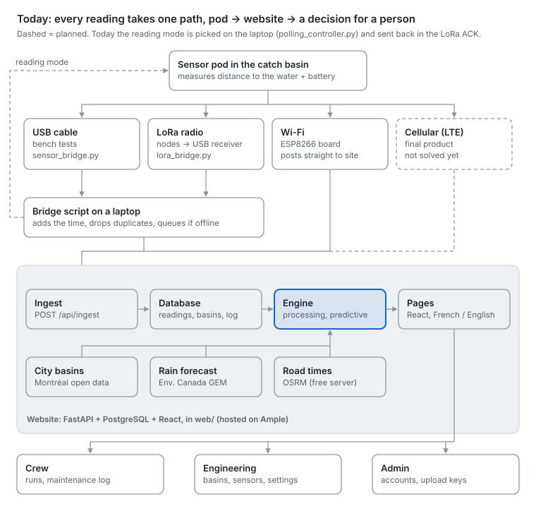

## 2. Users and their jobs

| Role | Must answer in under 10 seconds | Can change |
|---|---|---|
| **Crew** (tablet, in the truck) | Where do I go next, what do I do there, is it done? | Log exceptions only: couldn't clean, obstruction found, inspected, no issue found |
| **Engineering / public works** (desk) | Which basins before tonight's storm? What is flooding now? Is each sensor healthy? | Basins (as-built values), sensors, pre-storm runs (send, remove stops, departure time), on-call contact |
| **Admin** | Who has access? | Accounts (invite only), sensor upload keys |
| **Judges** (demo account) | What does the product do? | Only demo data, which is resettable |

The rules behind every screen:

- **Crew view first.** Raw telemetry, battery volts and hydrology parameters stay hidden until someone opens the engineering detail.
- **Sensor problems never look like basin problems:** grey for the sensor, red, orange or green for the basin.
- **Nothing routine to tap.** The sensor confirms a cleaning; people log only exceptions.

## 3. Screens

Required screens: sign-in and first-admin setup · Overview · Pre-storm run (with a printable / Excel cleaning list) · Crew view · Basins list + basin page · Add / edit basin · Sensors (health, raw readings) · Accounts · Upload keys · Change password. Global switches: Live / Pitch demo, French / English, light / dark.

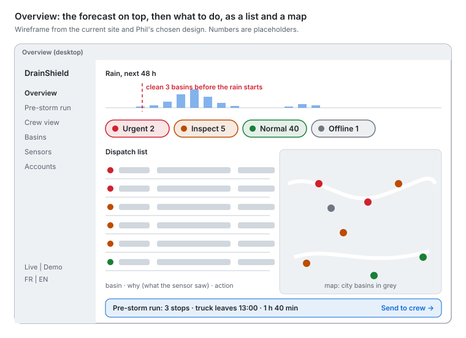

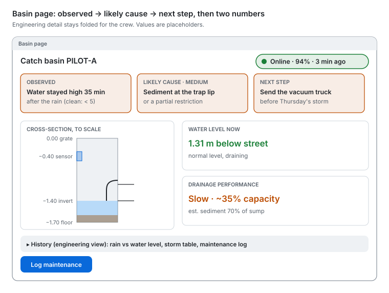

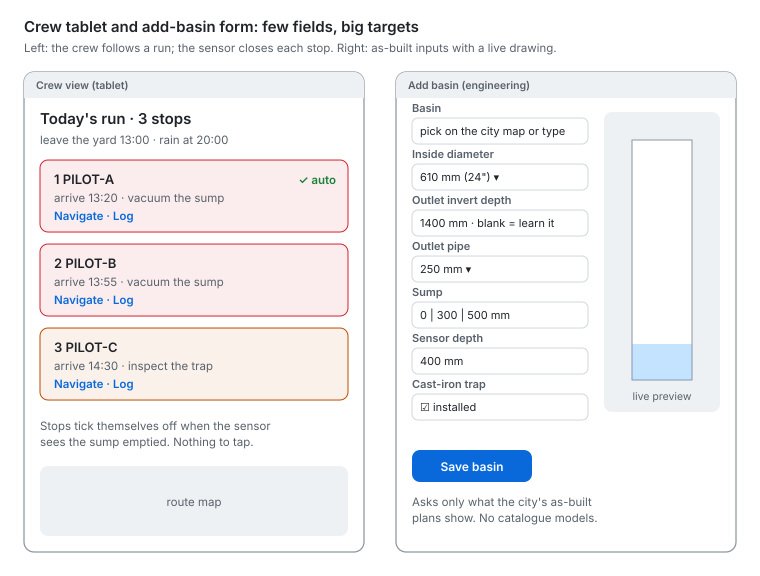

Screenshots of today's screens are in [HANDOFF.md, section 3](HANDOFF.md#the-site-today).

## 4. Data model

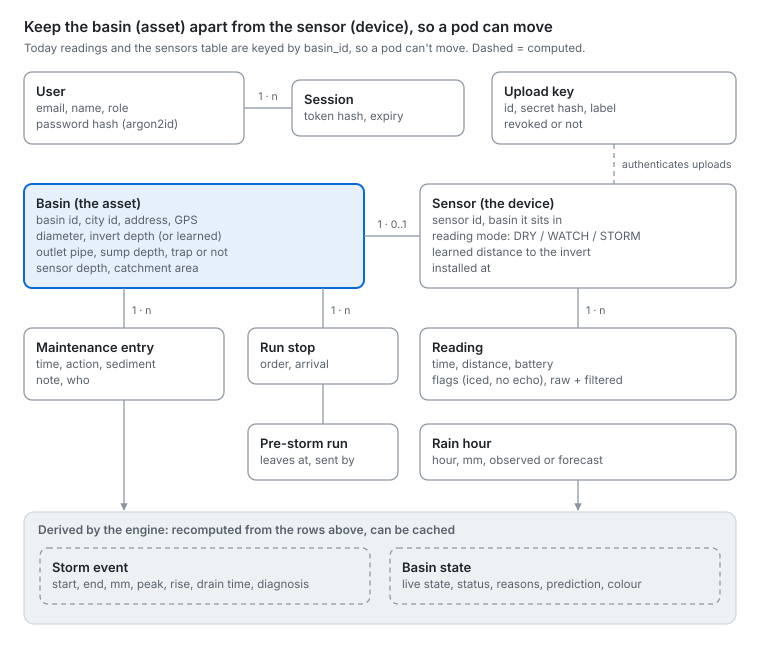

- **Keep the asset (basin) apart from the device (sensor).** Today both readings and sensor status are keyed by `basin_id`, so a pod can't move and keep its history.
- **Readings are append-only.** Ignore a duplicate (same sensor, same measured time), so retries are safe.
- **Store times in UTC and show them in America/Toronto.** Bridges send local time without a zone today.
- **Storm events and basin state are derived.** Recompute them from readings, rain and the log; caching is fine.

## 5. The decision engine: behaviour to keep

### 5.1 Water level

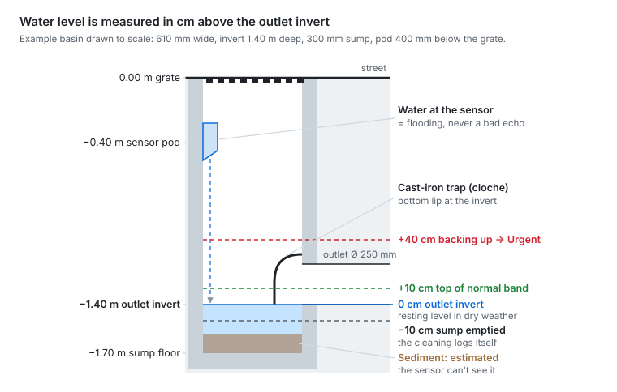

```
level_cm = (sensor_height − distance) − outlet_invert        (all in cm above the sump floor)
         = 0 at the outlet invert, the dry-weather resting level
```

**Self-calibration.** An hour counts as steady when it has ≥ 2 readings that vary < 1 cm. Take the first 48 steady hours after install. With ≥ 6 of them, the median distance *is* the distance to the invert. If the as-built invert depth is known and the learned value is more than 15 cm off, warn (sump not refilled, or bracket elsewhere). If the invert depth is unknown, the learned value sets it.

### 5.2 Pipeline

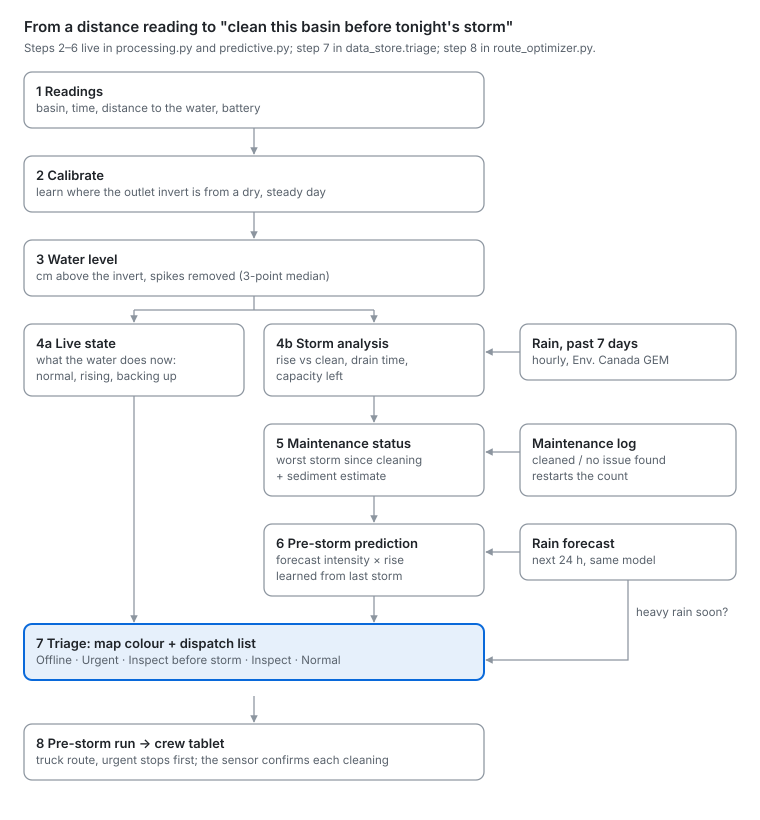

### 5.3 Storm diagnosis

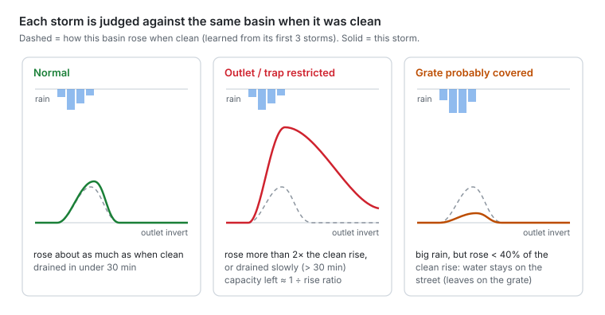

```
storm           = hours with rain, split by a dry gap ≥ 6 h; peak searched until 6 h after the rain
expected_rise   = k_clean × max(peak_intensity, 5 mm/h)
k_clean         = mean(peak / intensity) over the first 3 storms that rose ≥ 3 cm
                  (before that: 0.3 cm per mm/h × catchment_m² / 600)
rise_ratio      = peak / expected_rise
capacity_left   = 100% if rise_ratio ≤ 1.3, else 100 / rise_ratio
drain_time      = minutes from end of rain until level ≤ 3 cm
status (storm)  = worst of grade(rise_ratio; 2, 4, 8) and grade(drain_time; 30, 90, 180 min)
grate covered   = expected_rise ≥ 6 cm and rise_ratio < 0.4 (Watch) or < 0.2 (Clean soon)
sudden blockage = capacity ≤ 25% right after a storm at ≥ 70%
status (basin)  = worst storm since the last "Cleaned" or "No issue found", worst with sediment
sediment_cm     = at last cleaning + rain_mm × yield_kg/m²/yr ÷ 1000 mm × catchment_m² ÷ (1600 kg/m³ × basin_area_m²) × 100
```

`grade(x; a, b, c)` gives OK if x ≤ a, Watch if ≤ b, Clean soon if ≤ c, and Urgent otherwise.

### 5.4 Pre-storm prediction

```
predicted_peak = level_at_rain_start + k_now × i_obs × (i_forecast / i_obs)^p
    k_now      = cm per mm/h in the latest storm since the last cleaning
    p          = 1 if i_forecast ≤ i_obs, else 2 (restricted outlet ≈ orifice)
    i_forecast = wettest forecast hour in the next 24 h (ignored below 1 mm/h)
recovery_index = drain_time_now / drain_time_clean (both floored at 10 min)
red_at         = the lower of 40 cm and the level 30 cm below the grate
🔴  predicted_peak ≥ red_at
🟠  predicted_peak ≥ red_at ÷ 2, or recovery_index ≥ 3
```

### 5.5 Triage and lifecycle

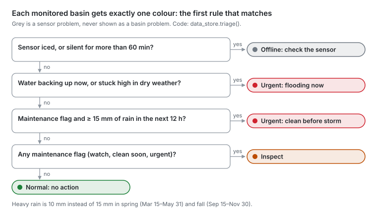

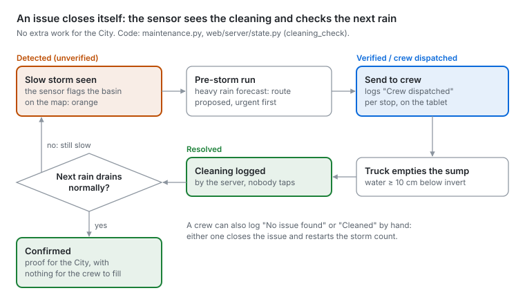

### 5.6 Every constant in one place

All are first guesses, to be tuned on pilot data. Keep them in one config file.

| Constant | Value | Today in |
|---|---|---|
| Normal band / backing up | 10 cm / 40 cm above the invert | `processing.py` |
| "Drained" / smallest rise worth judging | within 3 cm / 3 cm | `processing.py` |
| Sensor silent → offline | 60 min | `processing.py` |
| Battery empty–full / low / critical | 3.20–3.60 V / 3.35 V / 3.25 V | `processing.py` |
| Sediment Watch / Clean soon | 60% / 80% of the sump | `processing.py` |
| Heavy rain (clean before storm) | 15 mm in 12 h; 10 mm Mar 15–May 31 and Sep 15–Nov 30 | `weather.py`, `web/server/season.py` |
| Sump emptied → cleaning logged | ≥ 10 cm below the invert | `web/server/state.py` |
| Dry-baseline drift (trap blocked / evaporation) | +3 cm / −5 cm over 3 days | `predictive.py` |
| Grate covered while raining | flat (±1 cm) while neighbours within 400 m rise ≥ 5 cm in 45 min | `web/server/state.py` (to validate) |
| Route | road times from OSRM; fallback straight line × 1.35 at 25 km/h; on site 20 / 15 / 10 min (urgent / inspect / offline) | `route_optimizer.py` |

## 6. Sensor interface

```
POST /api/ingest
Authorization: Bearer dsk_<key id>_<secret>          (only sha256(secret) is stored)
{"readings": [
  {"basin_id": "S4-A", "timestamp": "2026-11-17T10:05:00", "distance_cm": 118.4,
   "battery_v": 3.52, "temp_c": 4.0, "flags": 0, "mode": "STORM"}      ← up to 5,000 per call
]}
→ {"accepted": 1, "duplicates": 0, "modes": {}, "season": {"key": "fall", "dry_every_s": 900}}
```

- **Flags (bit field):** 0x01 no echo · 0x02 water at the sensor · 0x04 suspect · 0x08 iced · 0x10 clock gap · 0x20 on USB.
- **Recommended change:** fill `modes` with each sensor's wanted reading mode, so the server decides, instead of the laptop script `polling_controller.py`.
- A packet can't reach a sleeping sensor, so firmware must still jump to STORM by itself when the water moves.

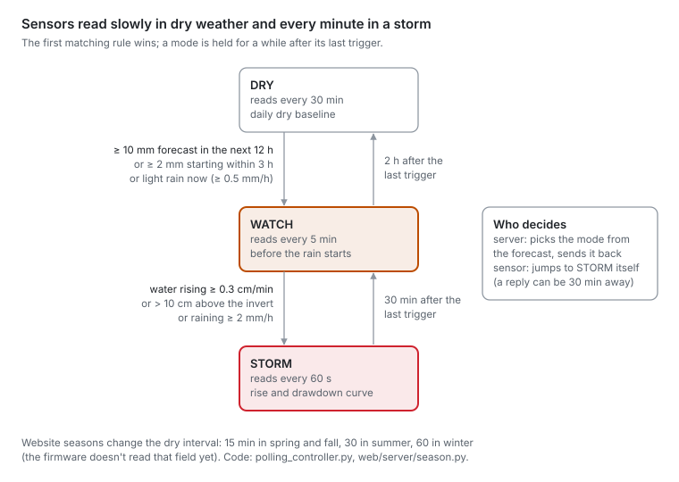

## 7. Constraints that survive any rewrite

- **Free, with no credit card, for now.** Portable, standard code that can move host.
- **Never add work or cost for the city.**
- **French and English** (Québec municipalities).
- **Honest UI:** sediment and capacity are labelled as estimates.
- **The pitch demo works with no rain and no internet:** fallbacks for the weather, routing and map tiles.
- **Invite-only accounts:** passwords hashed (argon2id today), sessions in HttpOnly cookies, rate-limited sign-in.
- **Design:** light, structured workspace (dark optional); forecast on top; table + map split; one accent colour; no generic "AI-looking" templates.

## 8. Suggested architecture, and what's open


| Choice | Today | Open to |
|---|---|---|
| Language / framework | Python FastAPI + React/TypeScript | anything Raph prefers |
| Database | PostgreSQL (SQLite locally) | any SQL; a time-series extension is optional |
| Engine | Python modules with global state | a pure library: inputs in, state out |
| Map | Leaflet + OpenStreetMap tiles | any; must degrade offline |
| Routing | public OSRM server | self-hosted OSRM, or another engine |
| Hosting | Ample free + Cloudflare relay for McGill | anything free with no card, until going public |

## 9. What to carry over, and how to know it's done

**Carry over as is:**
- `data/municipal_basins.csv` and `data/basin_priorities.csv` (the city's basins and pilot priority)
- The demo day: `demo_scenario.py` + `web/server/demo_registry.csv`
- The translations: `web/frontend/src/fr.ts`, `web/server/fr.py`
- The 43 tests (`tests/`, `web/tests/`) as acceptance cases

**Gap to close first:** the storm diagnosis in `processing.py` has no direct unit tests. Write golden cases from the demo day *before* rewriting it. (The demo's S4-A should flag "clean before storm" at 11:00.)

**Done when:**
- [ ] A sensor uploads with a key; a resent batch adds nothing
- [ ] A new sensor learns the invert after 6 steady dry hours, and warns when it's > 15 cm off the plans
- [ ] A storm rising > 2× the clean rise turns the basin orange; > 8× or water at the sensor turns it red
- [ ] A flagged basin + heavy rain in the next 12 h turns red ("clean before storm") and joins a pre-storm run, urgent first
- [ ] Water ≥ 10 cm below the invert logs a cleaning by itself; the next normal rain confirms it
- [ ] A sensor silent for 60 min shows grey, never red
- [ ] The demo day plays from 00:00 to 23:59 with no internet
- [ ] Every screen works in French and English, and the crew view on a tablet
- [ ] All of today's tests are ported and passing
