# DrainShield: rebuild-from-scratch spec

*Updated Nov 26, 2026, with Phil's direction after the Chambly interview. For Raph: Phil's advice is to look at what's built, then **start from scratch and reuse parts of the code** (see [HANDOFF.md](HANDOFF.md), section 1). [HANDOFF.md](HANDOFF.md) explains today's code; this file says **what the rebuilt product must do**. Anything not listed here is open.*

## 1. What changed in this version

- **No pitch demo, no judges' account, no sign-in page.** A role picker replaces sign-in. The demo is already removed from the code.
- **One sensor per zone, not per basin.** Chambly's public works foreman knows which areas cause trouble. One sensor in a zone of similar basins can stand in for the rest.
- **Batches, not single basins.** Contractors such as Sani-Vac are expensive, so work goes out in blocks of roughly half a day to a full day, never for a few scattered, non-critical basins. Cleaning takes about 5 minutes per basin, from arrival to done.
- **A 4-sensor pilot in Chambly:** 2 sensors where the foreman knows basins rarely block, 2 where they often do.
- **Sensors sleep in winter** and wake with the snowmelt. Battery: 3 years at first, 5–10 years as the goal.
- **Zones come from data, not field work:** public data first, then the city's office records.
- **Map first.** Foreman and engineering land on a colour-coded map with the forecast. The whole product is three screens.
- **French first.** English can stay as an option.
- **Colour-blind safe.** Every alert colour also has its own shape.

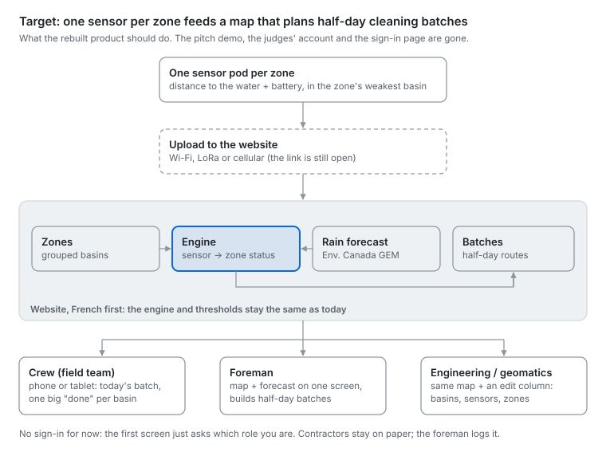

## 2. Roles: a picker instead of a sign-in page

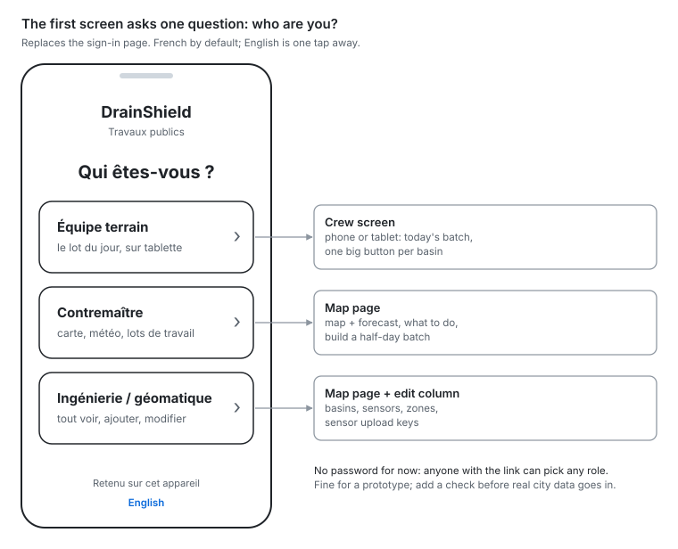

| Role | Device | Must answer in seconds | Can change |
|---|---|---|---|
| **Équipe terrain** (crew) | phone or tablet | Which basin next? Is it done? | Done / problem / skip, per basin |
| **Contremaître** (foreman) | computer or tablet | Which zones before the next storm? What's flooding now? | Build, print and send batches; log results (including the contractor's paper sheet) |
| **Ingénierie / géomatique** (engineering, geomatics) | computer | Is the network set up right? | Everything the foreman can, plus basins, sensors, zones and their risk factors, and sensor upload keys |

- **No password for now.** Phil decided anyone with the link can pick any role while this is a prototype. Add a check before real city data goes in.
- **The choice is remembered on the device**, and can be changed from the top bar.
- **Sensor upload keys stay.** Only real sensors can send readings.

## 3. Screens: three in total

Map and forecast stay on screen without scrolling. Everything else opens in a right-hand column.


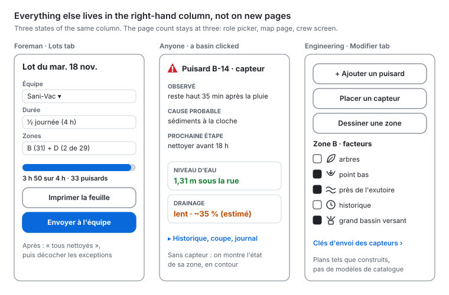

The crew screen has to be **very** easy, on both phone and tablet:

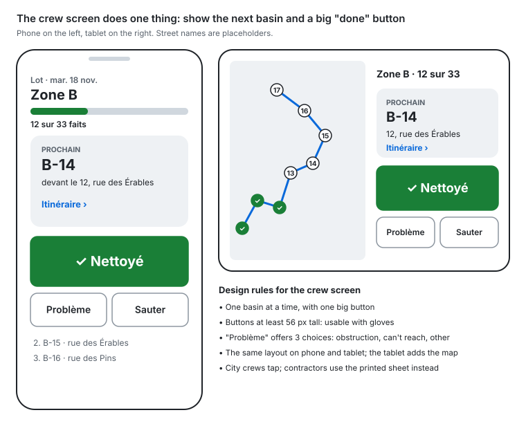

### Map legend: colour + shape, zones as outlines

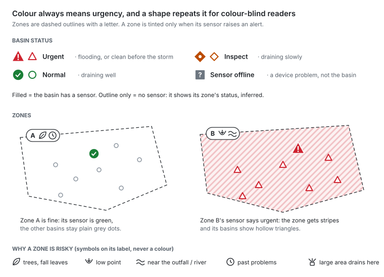

- **Colour only ever means urgency**, so zones never get their own colours. A zone is tinted (with stripes, so the basins inside stay visible) only when its sensor raises an alert.
- **What makes a zone risky** is shown with small symbols on its label.
- **Filled icon** = a basin with a sensor. **Outline icon** = no sensor; it shows its zone's status, inferred.

## 4. Zones: one sensor speaks for a group of basins

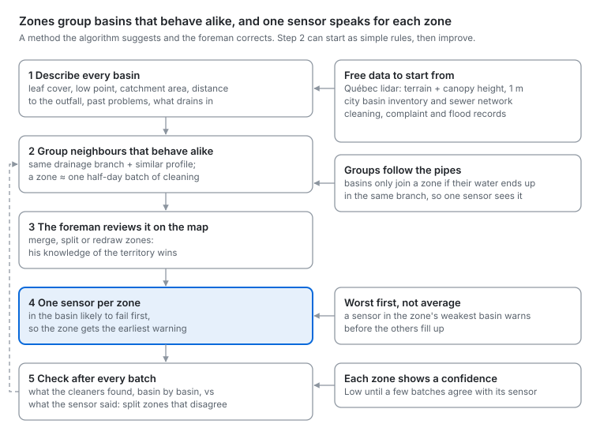

**Risk factors.** The first four come from Chambly's foreman; the rest are suggestions to check with cities.

| Factor | Why it matters | Data to measure it |
|---|---|---|
| Trees that drop leaves | grates clog in the fall | Québec lidar canopy height (1 m); city tree inventories |
| Low point | water and grit collect there | lidar terrain model (1 m), or NRCan HRDEM |
| Near the outfall / river | backs up when the river is high (spring) | city sewer network; river level |
| History of problems | the best single predictor | complaints, flood reports, the foreman's list |
| Large area draining in | more water and sediment | flow accumulation on the terrain model; `data/basin_priorities.csv` already has Dorval's catchment areas and low points |
| Paved lots, construction sites, gravel lanes upstream | heavy sediment loads | aerial photos, building permits |
| Winter sand route or snow dump nearby | spring grit | city operations |
| Flat street or flat pipe | sediment settles instead of washing through | terrain slope; pipe slopes from the sewer network |
| Basin design | no sump, small outlet, old basin | as-built plans, install date in the inventory |
| What the cleaners found | ground truth, if it's already on their sheet | optional; never a new task for the city |

**How to group, in practice:**

1. **Start with rules.** Basins on the same street segments that share the same factors form a candidate zone. The foreman corrects it on the map in an afternoon.
2. **Then improve the grouping.** Give each basin a profile (the factors above, scaled 0–1). Join neighbours only along the drainage network, so water from every basin in a zone ends up in the same branch. Merge the most similar neighbours until a zone is about one half-day batch. This is a "spatially constrained" clustering (agglomerative clustering on the network graph).
3. **Put the sensor in the zone's weakest basin**, the one with the highest risk, so the zone gets the earliest warning.
4. **Show a confidence per zone.** It's Low at first. It rises when the cleaners' findings agree with what the sensor said, and a zone that keeps disagreeing gets split.

### Objective data, with no field work

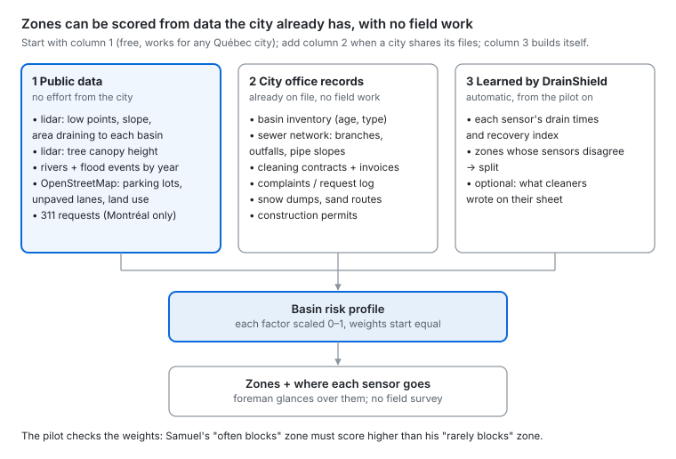

The city's crews shouldn't have to collect anything. Each factor above can be measured from one of three sources, in this order:

| Source | What it gives | Effort for the city |
|---|---|---|
| **Québec lidar** ([Données Québec](https://donneesquebec.ca/recherche/dataset/donnees-lidar-du-quebec); [1 m terrain + canopy models](https://ouvert.canada.ca/data/fr/dataset/5e5d2750-d129-4952-b9fc-f824c5e480b4)), or NRCan [HRDEM](https://open.canada.ca/data/en/dataset/957782bf-847c-4644-a757-e383c0057995) | low points (depression depth), slope, the area draining to each basin (flow accumulation), tree canopy height near each basin | none |
| **Flood history:** MSP flood events by year ([2019 example](https://donneesquebec.ca/recherche/dataset/cartographie-des-inondations-printemps-2019)); NRCan historical flood events | which neighbourhoods have flooded before (coarse, mostly river floods) | none |
| **OpenStreetMap** | parking lots, unpaved lanes, land use around each basin | none |
| **Montréal open data:** [311 requests](https://www.donneesquebec.ca/recherche/dataset/vmtl-requete-311), [public trees](https://donneesquebec.ca/recherche/dataset/vmtl-arbres), [canopy](https://www.donneesquebec.ca/recherche/dataset/vmtl-canopee) | complaint history and tree species (Ville de Montréal territory only, so not Chambly) | none |
| **City office records** | basin inventory (age, type), sewer network (branches, outfalls, pipe slopes), cleaning contracts and invoices, complaint log, snow dumps and sand routes, construction permits | send files once |
| **DrainShield itself** | each sensor's drain times and recovery index; zones whose sensors disagree | none |

**Scoring:** every factor is scaled 0–1 per basin, with equal weights to start. The pilot then checks the weights: the foreman's "often blocks" zone has to score higher than his "rarely blocks" zone. If it doesn't, the weights are wrong.

## 5. Batches: enough work to be worth the trip

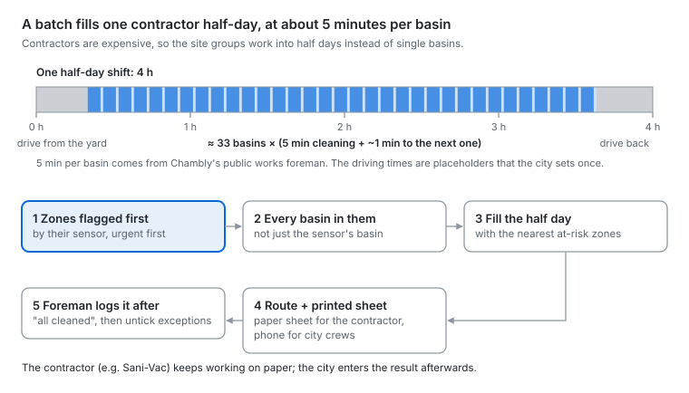

- **Half a day is a rule of thumb, and a full day works the same way.** Default 4 h, editable per city; 5 min on site per basin; driving times from the road network.
- **Never send a contractor for a few scattered, non-critical basins.** They wait and join the next batch in that area.
- **Urgent before a storm is the exception:** the city's own crew goes, or the basin is added to a batch already out.
- **A batch always takes whole zones**, urgent zones first, then nearby at-risk zones until the shift is full.
- **Output:** a route, a printable sheet for the contractor, and the crew screen for city crews.
- **Logging:** the foreman taps "all cleaned", then unticks the basins that weren't done.

## 6. Pilot: 4 sensors in Chambly

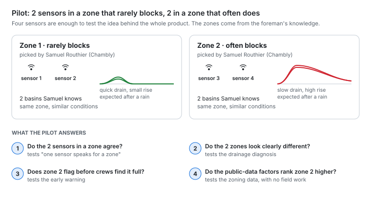

Samuel Routhier, Chambly's public works foreman, picks the basins. The software needs very little for the pilot: two zones drawn by hand, the sensor basin pages, and a view that puts the two sensors of a zone side by side.

## 7. Seasons and battery

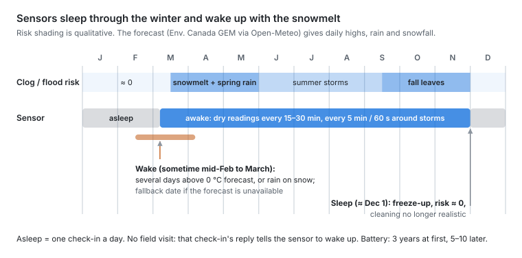

- **Winter: asleep.** Clogging risk is near zero, so the sensor checks in once a day (battery, "still alive") and nothing else. Nobody goes out to remove pods.
- **Wake-up without a field visit.** The server's reply to the daily check-in says "wake up" when the forecast shows several days above 0 °C, or rain on snow. Open-Meteo's GEM feed gives daily highs and lows, rain and snowfall. A fallback date is used if the forecast is unavailable.
- **Awake from the snowmelt to freeze-up** (spring, summer, fall), through the biggest flood season, until cleaning is no longer realistic (≈ Dec 1).
- **"Offline" must follow the season:** a sleeping sensor is only offline after it misses a daily check-in (more than 26 h), not after 60 min.
- **Battery: 3 years at first, 5–10 years as the goal.** At today's season settings (dry readings every 15 min in spring and fall, 30 in summer, 60 in winter), a sensor takes about 22,500 dry readings a year. Sleeping in winter cuts that to about 20,000. The bigger levers are the 15-minute spring/fall interval and **how often the radio sends**: send readings in bundles, not one by one. Real battery life needs a bench test with the final radar and radio.

## 8. Data model


- **Readings are append-only.** Ignore a duplicate (same sensor, same measured time).
- **Store times in UTC and show them in America/Toronto.**
- **Zone state = its sentinel's basin state.** Recompute derived things, and cache them.

## 9. The decision engine (keep today's rules)

The engine judges **sensor basins** exactly as today. The zone layer sits on top of it.

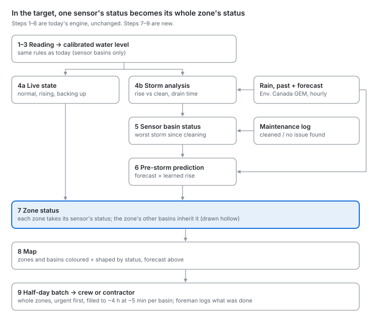

### 9.1 Water level


```
level_cm = (sensor_height − distance) − outlet_invert     (cm above the sump floor)
         = 0 at the outlet invert, the dry-weather resting level
```

**Self-calibration:** an hour counts as steady when it has ≥ 2 readings that vary < 1 cm. Take the first 48 steady hours after install. With ≥ 6 of them, the median distance *is* the distance to the invert. If that's more than 15 cm off the as-built depth, warn.

### 9.2 Storm diagnosis and prediction


```
storm           = hours with rain, split by a dry gap ≥ 6 h; peak searched until 6 h after the rain
expected_rise   = k_clean × max(peak_intensity, 5 mm/h)
k_clean         = mean(peak / intensity) over the first 3 storms that rose ≥ 3 cm
                  (before that: 0.3 cm per mm/h × catchment_m² / 600)
rise_ratio      = peak / expected_rise ;  capacity_left = 100% if ≤ 1.3, else 100 / rise_ratio
drain_time      = minutes from end of rain until level ≤ 3 cm
status (storm)  = worst of grade(rise_ratio; 2, 4, 8) and grade(drain_time; 30, 90, 180 min)
grate covered   = expected_rise ≥ 6 cm and rise_ratio < 0.4 (Watch) or < 0.2 (Clean soon)
status (basin)  = worst storm since the last cleaning, worst with the sediment estimate

predicted_peak  = level_at_rain_start + k_now × i_obs × (i_forecast / i_obs)^p   (p = 1 lighter, 2 heavier)
red_at          = the lower of 40 cm and the level 30 cm below the grate
red if predicted_peak ≥ red_at ; orange if ≥ red_at ÷ 2, or drains 3× slower than when clean
```

`grade(x; a, b, c)` gives OK if x ≤ a, Watch if ≤ b, Clean soon if ≤ c, and Urgent otherwise.

### 9.3 Triage, zones and the issue cycle


The first matching rule gives each **sensor** its status. Its **zone** takes that status, and the zone's other basins show it with outline icons.

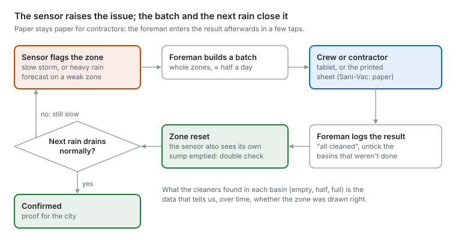

### 9.4 Every constant in one place

All of these are first guesses. Keep them in one config file the city can tune.

| Constant | Value | Source |
|---|---|---|
| Normal band / backing up | 10 cm / 40 cm above the invert | `processing.py` |
| Sensor silent → offline | 60 min | `processing.py` |
| Sediment Watch / Clean soon | 60% / 80% of the sump | `processing.py` |
| Heavy rain (clean before storm) | 15 mm in 12 h; 10 mm Mar 15–May 31 and Sep 15–Nov 30 | `weather.py`, `web/server/season.py` |
| Sump emptied → cleaning logged | ≥ 10 cm below the invert (sensor basins only) | `web/server/state.py` |
| **Time on site per basin** | **≈ 5 min** | Chambly public works foreman |
| **Batch length** | **rule of thumb: half a day to a full day (default 4 h)** | Chambly public works foreman |
| Winter sleep | ≈ Dec 1 until the snowmelt; 1 check-in a day; offline after 26 h without one | proposed here |
| Battery empty–full | 3.20–3.60 V | `processing.py` |

## 10. Sensor interface (unchanged)

```
POST /api/ingest
Authorization: Bearer dsk_<key id>_<secret>
{"readings": [{"basin_id": "B-14", "timestamp": "2026-11-17T10:05:00", "distance_cm": 118.4,
               "battery_v": 3.52, "flags": 0, "mode": "STORM"}]}           ← up to 5,000 per call
→ {"accepted": 1, "duplicates": 0, "modes": {}, "season": {"key": "fall", "dry_every_s": 900}}
```

**Flags:** 0x01 no echo · 0x02 water at the sensor · 0x04 suspect · 0x08 iced · 0x10 clock gap · 0x20 on USB. The reply's `modes` should carry each sensor's wanted reading mode, so the server decides it.


## 11. Constraints that survive any rewrite

- **Three screens:** role picker, map page, crew screen. New things go in the map page's column, not new pages.
- **The crew screen:** one basin at a time, buttons ≥ 56 px, phone and tablet.
- **French by default.** English optional.
- **Colour + shape** for every status. Sensor problems (grey square) never look like basin problems.
- **Never add work or cost for the city.** Contractors keep their paper; the foreman logs in a few taps.
- **Estimates are labelled as estimates** (sediment, capacity, inferred zone status).
- **Free, with no credit card, for now.** Portable, standard code.

## 12. Suggested architecture

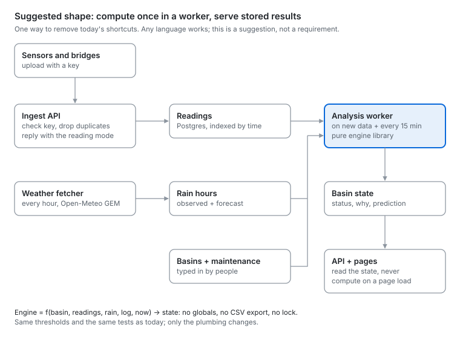

Add a **zone job** next to the analysis worker. It recomputes the suggested zones when basins, factors or cleaning results change, and never overwrites the foreman's edits.

## 13. What to carry over, and how to know it's done

**Carry over:** `data/municipal_basins.csv`, `data/basin_priorities.csv` (catchment areas and low points: a head start on zoning), the French translations (`web/frontend/src/fr.ts`, `web/server/fr.py`), and the 39 remaining tests.

**Gap:** the end-to-end test that used the pitch demo was removed along with the demo. Write a small synthetic storm (a few basins, one rain event, a cleaning) as a test fixture *before* rewriting the engine.

**Done when:**

- [ ] The first screen offers the three roles, in French, and remembers the choice
- [ ] The map shows zones as outlines with letters and factor symbols, and basins with colour + shape icons, with the forecast above it, without scrolling
- [ ] A zone's sensor turning orange or red stripes the zone and turns its other basins into outline icons
- [ ] Engineering can add a basin, place a sensor, draw a zone and tick its factors from the column
- [ ] The foreman can build a batch of half a day to a full day at 5 min per basin, print it, and log it as "all cleaned except…"
- [ ] Scattered, non-critical basins wait for the next batch nearby instead of triggering a trip
- [ ] Sensors sleep in winter (one check-in a day), wake from the forecast with no field visit, and aren't shown offline while asleep
- [ ] Zones can be scored from public data alone, before any city file arrives
- [ ] The crew screen works one-handed on a phone and on a tablet
- [ ] A sensor silent for 60 min shows a grey square, never red
- [ ] Sensor uploads keep working, and a resent batch adds nothing
- [ ] Today's tests are ported and passing, plus the synthetic storm test

**Questions to settle with Phil:**

- Can Chambly share its sewer network, basin inventory and past cleaning records (office files, no field work)?
- Which 2 + 2 basins will Samuel pick, and when do the pods go in?
- Which radio (LTE, LoRaWAN, Wi-Fi) the final pod uses: it decides how readings are bundled, and the battery life.
- What does the contractor's paper sheet look like, so the printout matches it?
